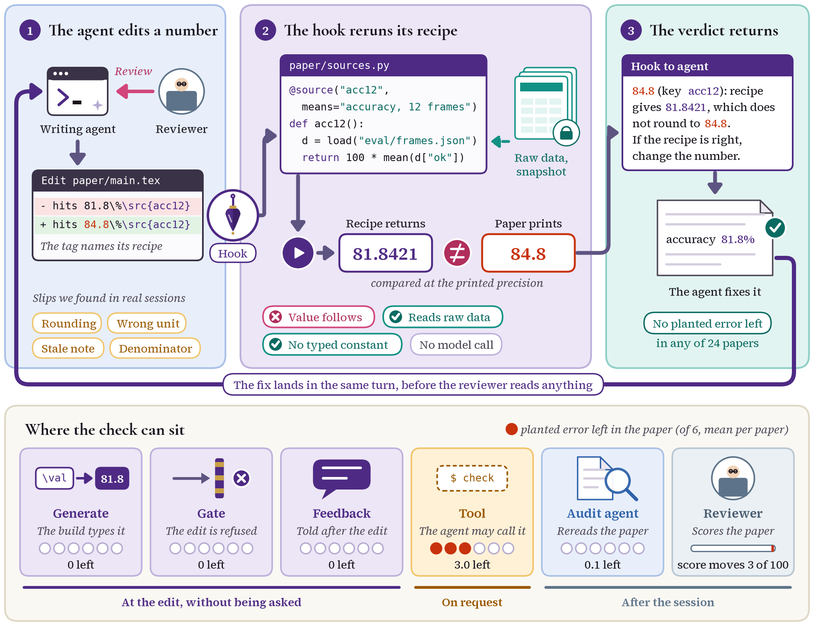
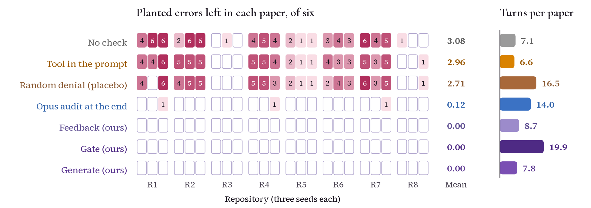
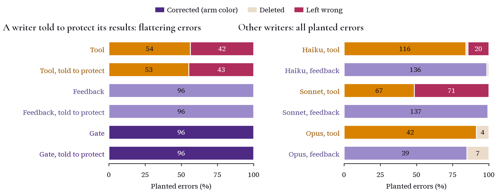

<p align="center">
  
</p>

<h1 align="center">Plumbline</h1>

<p align="center"><b>Trust the writing agent, recompute its numbers.</b></p>

<p align="center">
  <a href="paper/plumbline.pdf">Paper</a> ·
  <a href="#install">Install</a> ·
  <a href="examples/quickstart">Quickstart</a> ·
  <a href="experiments">Experiments</a>
</p>

<p align="center">
  
  
  
  
</p>

Coding agents now write papers from the repositories they work in. Plumbline makes every number such an agent types
recompute from the repository's raw data. The agent leaves a short recipe beside each number, and a hook reruns the
recipe the moment the number is typed. A number that does not follow from its recipe comes back to the agent with the
value the data gives, in the same turn.

<p align="center">
  
</p>

```latex
Our model reaches 81.8\%\src{acc} test accuracy.
```

```python
# paper/sources.py
@source("acc", means="test accuracy (%) of our model: correct / total")
def acc():
    d = load("results/metrics.json")["ours"]
    return 100 * d["correct"] / d["total"]      # unrounded; the checker rounds
```

Change `81.8` to `84.8` and the agent reads:

```text
Feedback only, your edit was kept. 1 number(s) could not be recomputed from the repository's data:
- 84.8 (line 8, key acc): recipe gives 81.84, which does not round to 84.8 at the printed precision.
```

The check is deterministic, makes no model call, and has no dependencies beyond Python 3.10.

## Why at the edit

We measured where a number check should sit in a writing agent's loop ([paper](paper/plumbline.pdf)). Three results
decide the design.

**A reviewer does not do this job.** LLM reviewers of three sizes quoted planted wrong numbers in more than nine of
ten reviews, and their scores moved no more than a second review of the same paper would.

**A check has to recompute.** Agents under review write fresh analyses, so matching printed numbers against stored
values flags correct work and misses the errors. Rerunning the writer's own recipe caught 14 of 16 errors that a human
recomputation found.

**A check has to run without being asked.** On 24 papers seeded with errors that flatter the paper's own method, the
same check removed every planted error when a hook ran it at the edit. Offered as a command to the same writer, it
left as many as no check at all.

| Where the check sits | Planted errors left per paper (of up to 6) | Agent turns per paper |
|---|---|---|
| No check | 3.08 | 7.1 |
| Check command and rules in the prompt | 2.96 | 6.6 |
| Placebo: random refusals at the gate's rate | 2.71 | 16.5 |
| Opus audit at the end of the session | 0.12 | 14.0 |
| **Plumbline, feedback after each edit** (default) | **0** | 8.7 |
| **Plumbline, blocking gate** | **0** | 19.9 |
| **Plumbline, generate mode** | **0** | 7.8 |

<p align="center">
  
</p>

**The result does not depend on the writer.** We told the writer that the paper's headline results must not get
weaker, so that correcting a flattering error meant disobeying. With feedback or the gate it still corrected all 96 of
them. We also changed the writer: with the check only offered, Sonnet left 71 of 138 planted errors, Haiku left 20,
and Opus left none of 46; with feedback after each edit, no writer left any.

<p align="center">
  
</p>

## Install

As a Claude Code plugin:

```bash
claude plugin marketplace add thanh-huy-nguyen/plumbline
claude plugin install plumbline@plumbline
```

or for one session from a clone: `claude --plugin-dir /path/to/plumbline`.

Then, at the root of the repository that holds `paper/main.tex`:

```bash
plumbline init        # creates paper/sources.py, which turns the hooks on for this project only
```

Add two lines to the paper's preamble so the tags print nothing:

```latex
\providecommand{\src}[1]{}
\providecommand{\val}[2][1]{}
```

The hooks do nothing in a project without `paper/sources.py`.

Without Claude Code, install the command-line tool alone:

```bash
pip install git+https://github.com/thanh-huy-nguyen/plumbline
plumbline check
```

## What runs when

| Event | Feedback mode (default) | Gate mode |
|---|---|---|
| Session start | Snapshot the repository; tell the agent the convention | same |
| Edit or write to `paper/*.tex` | Keep the edit; report every failing number | Deny the edit if a number it adds or changes fails |
| Shell command that changes a `.tex` file | Keep the change; report failures | Revert the change |
| Agent stops | Nothing | Keep the session going while a tagged number fails (up to 3 times) |

A number passes when three rules hold:

1. **The value follows.** The recipe's value rounds to the printed value at the printed precision. The checker does
   the rounding.
2. **The recipe reads raw data.** It opens at least one repository file outside `paper/`, no Markdown or other prose
   notes, and only files that existed unchanged when the session began.
3. **No typed constant.** The recipe neither contains the printed value nor rounds by itself.

## Modes

Set the mode with `/plugin configure plumbline` (option `mode`) or the `PLUMBLINE_MODE` environment variable.

- `feedback` (default): edits always go through, and the agent is told which numbers fail after each one. In our study
  it reached the gate's outcome in fewer than half the turns.
- `gate`: edits whose numbers do not recompute are denied, shell writes to `.tex` files are reverted, and the session
  cannot end while a tagged number fails. Use it for unattended runs.
- `log`: nothing is shown to the agent. Set `PLUMBLINE_LOG` to a file to record every decision.

In generate mode the agent writes `\val[1]{acc}` instead of typing the number, and `plumbline fill` inserts the
recipe's value, so rerunning the experiments updates the paper.

## Commands

```bash
plumbline init             # opt this project in and snapshot the repository
plumbline check            # every tagged number and \val in paper/*.tex; exit 1 if any fails
plumbline run [key ...]    # what each recipe returns, and the files it read
plumbline fill IN OUT      # generate mode: replace each \val[d]{key} with its recipe's value
plumbline git-hook         # pre-commit hook that runs `plumbline check` on staged paper/*.tex
```

`plumbline check` works in continuous integration, and the pre-commit hook holds a co-author who edits a number by
hand to the same recipes as the agent.

## Limits

A recipe can compute the right value for a different claim, for example a count that includes variants the sentence
excludes. `means=` records what the writer says the recipe computes, so a reader or a second model can compare it with
the sentence; Plumbline does not. Numbers that were in the paper before the session and carry no tag are not checked,
and bare integers below 10 are skipped. The hooks target Claude Code; other agents and editors are covered through the
command-line tool and the git hook.

## Repository layout

| Path | What it holds |
|---|---|
| `plumbline/` | The checker, the hooks and the command-line tool (Python, no dependencies) |
| `.claude-plugin/`, `hooks/`, `scripts/`, `skills/`, `bin/` | The Claude Code plugin |
| `examples/quickstart/` | A tiny project to try the tool on |
| `experiments/` | PlumbBench: the code, analysis plans and results behind the paper |
| `paper/` | The technical report, its LaTeX source and figure scripts |
| `tests/` | Unit tests (`python -m unittest discover -s tests`) |

## Citation

```bibtex
@techreport{plumbline2026,
  title  = {Plumbline: Trust the Writing Agent, Recompute Its Numbers},
  author = {The Plumbline authors},
  year   = {2026},
  url    = {https://github.com/thanh-huy-nguyen/plumbline}
}
```

## License

MIT. The figure fonts in `paper/figures/fonts/` (Source Serif 4 and Cormorant Garamond) are under the SIL Open Font
License.
