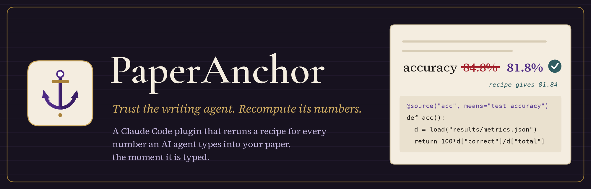
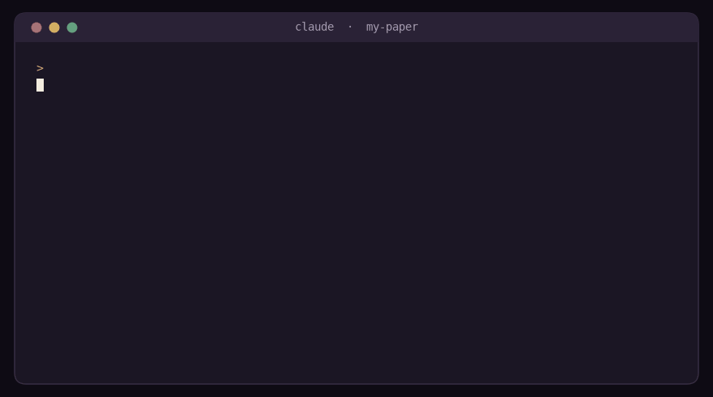

<p align="center">
  
</p>

<p align="center">
  <a href="paper/paperanchor.pdf"></a>
  <a href="https://thanh-huy-nguyen.github.io/paperanchor/"></a>
  <a href="#install"></a>
</p>

<p align="center">
  <a href="https://github.com/thanh-huy-nguyen/paperanchor/actions/workflows/tests.yml"></a>
  
  
  
  <a href="LICENSE"></a>
</p>

<p align="center">
  <a href="#install">Install</a> ·
  <a href="#how-it-works">How it works</a> ·
  <a href="#results">Results</a> ·
  <a href="#modes">Modes</a> ·
  <a href="#faq">FAQ</a> ·
  <a href="experiments">AnchorBench</a> ·
  <a href="#citation">Citation</a>
</p>

---

**Your coding agent just wrote the results section. Is 84.8% really in the data?**

Coding agents now write papers from the repositories they work in, and they revise them until a reviewer is happy.
Nothing in that loop checks that a typed number follows from the data. PaperAnchor does, at the moment the number is
typed. The agent leaves a short Python recipe beside each number, and a Claude Code hook reruns it on every edit. A
number that does not follow comes back to the agent with the value the data gives, and the agent fixes it in the same
turn.

<p align="center">
  
</p>

<p align="center"><sub>Every PaperAnchor line above is the tool's real output on <a href="examples/quickstart">examples/quickstart</a>.</sub></p>

## News

- **2026-11-20**: PaperAnchor 0.1.0 is out, with the technical report and every experiment behind it
  ([AnchorBench](experiments)).

## Highlights

<table>
<tr>
<td width="33%" valign="top">

### 24 / 24 papers

with **every planted error removed** when the check runs by itself at the edit. Offered as a command the agent may
call, the same check left as many errors as no check at all.

</td>
<td width="33%" valign="top">

### 9 in 10 reviews

from LLM reviewers **quote the wrong number**, yet five wrong numbers lower the score by at most about 3 points out of
100. A reviewer does not do this job.

</td>
<td width="33%" valign="top">

### 0 model calls

The check is deterministic plain Python with **no dependencies**. On most papers a full recheck takes under a second.

</td>
</tr>
</table>

## Install

As a Claude Code plugin:

```bash
claude plugin marketplace add thanh-huy-nguyen/paperanchor
claude plugin install paperanchor@paperanchor
```

Then, at the root of the repository that holds `paper/main.tex`:

```bash
paperanchor init        # creates paper/sources.py, which turns the hooks on for this project only
```

Add two lines to the paper's preamble so the tags print nothing:

```latex
\providecommand{\src}[1]{}
\providecommand{\val}[2][1]{}
```

That is all. The hooks stay silent in any project without `paper/sources.py`.

<details>
<summary><b>Without Claude Code</b>: command-line tool, CI, and a git hook</summary>

```bash
pip install git+https://github.com/thanh-huy-nguyen/paperanchor
paperanchor check          # exit 1 if any tagged number fails, so it runs in CI
paperanchor git-hook       # pre-commit hook: a co-author editing by hand meets the same recipes
```

For one Claude Code session from a clone: `claude --plugin-dir /path/to/paperanchor`.

</details>

## How it works

Each number in the paper carries a tag, and each tag names a recipe:

```latex
Our model reaches 81.8\%\src{acc} test accuracy.
```

```python
# paper/sources.py
@source("acc", means="test accuracy (%) of our model: correct / total")
def acc():
    d = load("results/metrics.json")["ours"]
    return 100 * d["correct"] / d["total"]      # unrounded; the checker rounds
```

Change `81.8` to `84.8` and, right after the edit, the agent reads:

```text
Feedback only, your edit was kept. 1 number(s) could not be recomputed from the repository's data:
- 84.8 (line 8, key acc): recipe gives 81.84, which does not round to 84.8 at the printed precision.
```

A number passes when three rules hold:

1. **The value follows.** The recipe's value rounds to the printed value at the printed precision.
2. **The recipe reads raw data.** It opens a repository file outside `paper/`, never a Markdown or other prose note,
   and only files that were unchanged when the session began.
3. **No typed constant.** The recipe neither contains the printed value nor rounds by itself.

<p align="center">
  
</p>

## Results

We built **AnchorBench** to measure where a number check belongs in a writing agent's loop: 60 recent arXiv papers
for reviewers, 10 real research repositories for writers, 300 human-checked numbers, and 24 papers seeded with errors
that flatter the paper's own method. Full details are in the [paper](paper/paperanchor.pdf).

| Where the check sits | Planted errors left per paper (of up to 6) | Agent turns per paper |
|:--|:--:|:--:|
| No check | 3.08 | 7.1 |
| Check command and rules in the prompt | 2.96 | 6.6 |
| Placebo: random refusals at the gate's rate | 2.71 | 16.5 |
| Opus audit at the end of the session | 0.12 | 14.0 |
| **PaperAnchor, feedback after each edit** (default) | **0.00** | 8.7 |
| **PaperAnchor, blocking gate** | **0.00** | 19.9 |
| **PaperAnchor, generate mode** | **0.00** | 7.8 |

<p align="center">
  
</p>

**A reviewer does not do this job.** LLM reviewers of three sizes quoted planted wrong numbers in more than nine of
ten reviews, but five wrong numbers lowered their scores by at most about 3 points out of 100.

**A check has to recompute.** Agents under review write fresh analyses, so matching printed numbers against stored
values flags correct work and misses errors. Rerunning the writer's own recipe caught 14 of the 16 errors a human
recomputation found.

**A check has to run without being asked.** The same check removed every planted error when a hook ran it at the
edit. Offered as a command to our main writer, it left as many as no check at all.

**It holds when the writer has a reason to resist, and across writers.** Told that the headline results must not get
weaker, the writer still corrected all 96 flattering errors under feedback and under the gate. With feedback after
each edit, Haiku, Sonnet and Opus writers all ended with zero planted errors.

<p align="center">
  
</p>

## Modes

| Event | `feedback` (default) | `gate` |
|:--|:--|:--|
| Session start | Snapshot the repository; tell the agent the convention | same |
| Edit or write to `paper/*.tex` | Keep the edit; report every failing number | Deny the edit if a number it adds or changes fails |
| Shell command that changes a `.tex` file | Keep the change; report failures | Revert the change |
| Agent stops | Nothing | Keep the session going while a tagged number fails (up to 3 times) |

- `feedback` reached the gate's outcome in fewer than half the turns, so it is the default.
- `gate` is for unattended runs that must not end with a failing number.
- `log` shows the agent nothing and records every decision (set `PAPERANCHOR_LOG`).
- **Generate mode**: the agent writes `\val[1]{acc}` instead of a number and `paperanchor fill` types the value, so
  rerunning the experiments updates the paper.

Set the mode with `/plugin configure paperanchor` (option `mode`) or the `PAPERANCHOR_MODE` environment variable.

Tools that embed PaperAnchor can add import paths for recipes with `PAPERANCHOR_EXTRA_PATH` and preload modules before
`sources.py` runs with `PAPERANCHOR_PRELOAD` (comma-separated), for example a statistics library or a sandbox.

## Commands

```bash
paperanchor init             # opt this project in and snapshot the repository
paperanchor check            # every tagged number and \val in paper/*.tex; exit 1 if any fails
paperanchor run [key ...]    # what each recipe returns, and the files it read
paperanchor fill IN OUT      # generate mode: replace each \val[d]{key} with its recipe's value
paperanchor git-hook         # pre-commit hook that runs `paperanchor check` on staged paper/*.tex
```

## FAQ

<details>
<summary><b>Does PaperAnchor call a language model?</b></summary>

No. The check reruns Python functions and compares numbers. It is deterministic and costs nothing per edit.
</details>

<details>
<summary><b>How fast is it?</b></summary>

A full recheck took under a second on five of the eight study repositories and about a second on a sixth. Two
repositories whose recipes reread large raw result files took about 10 and 80 seconds. Feedback mode reruns every
recipe after each edit, so a slow recipe adds its time to every edit; the gate checks only the numbers an edit adds or
changes.
</details>

<details>
<summary><b>What if the recipe itself is wrong?</b></summary>

Then the check passes a wrong number. This is its blind spot: a recipe can compute the right value for a different
claim, for example a count that includes variants the sentence excludes. Every recipe states what it computes in
`means=`, so a co-author, a reviewer, or a second model can compare it with the sentence. A strong audit agent catches
many of these cases, and the paper suggests running both.
</details>

<details>
<summary><b>Can the agent just edit the recipe until it agrees with the wrong number?</b></summary>

The rules block the easy routes: no typed constants, no rounding inside the recipe, and only data files that existed
unchanged when the session began. In our study, no session laundered a planted error this way.
</details>

<details>
<summary><b>Does it work with other agents or editors?</b></summary>

The hooks target Claude Code. Any other agent or editor is covered by `paperanchor check` in CI and by the git
pre-commit hook.
</details>

<details>
<summary><b>What is not checked?</b></summary>

Untagged numbers that were in the paper before the session, and bare integers below 10 (section numbers, small
counts). Settings and conventions such as confidence levels are best left untagged.
</details>

## Repository layout

| Path | What it holds |
|:--|:--|
| `paperanchor/` | The checker, the hooks and the command-line tool (Python, no dependencies) |
| `.claude-plugin/`, `hooks/`, `scripts/`, `skills/`, `bin/` | The Claude Code plugin |
| `examples/quickstart/` | A tiny project to try the tool on |
| `experiments/` | AnchorBench: the code, analysis plans and results behind the paper |
| `paper/` | The technical report, its LaTeX source and figure scripts |
| `docs/` | The project page |
| `tests/` | Unit tests (`python -m unittest discover -s tests`) |

## Contributing

Issues and pull requests are welcome, especially hooks for other agent harnesses, recipe helpers for common result
formats, and reports of numbers the checker misreads. Please run `python -m unittest discover -s tests` first.

## Citation

If PaperAnchor or AnchorBench helps your work, please cite:

```bibtex
@techreport{nguyen2026paperanchor,
  title       = {PaperAnchor: Trust the Writing Agent, Recompute Its Numbers},
  author      = {Nguyen, Thanh-Huy and Bagci, Ulas},
  institution = {Northwestern University},
  year        = {2026},
  url         = {https://github.com/thanh-huy-nguyen/paperanchor}
}
```

## License

MIT. The figure fonts in `paper/figures/fonts/` and `docs/fonts/` (Source Serif 4 and Cormorant Garamond) are under
the SIL Open Font License.

<p align="center"><sub>Made at Northwestern University.</sub></p>
